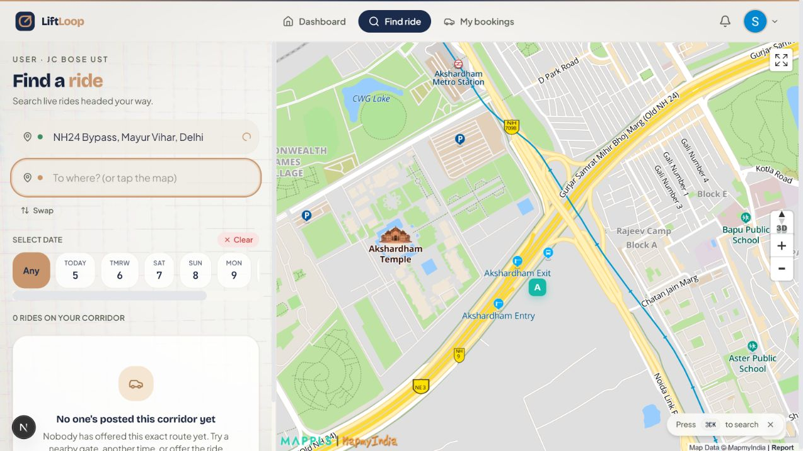

# LiftLoop functional audit — 5 November 2026

## Verdict and coverage

The app is not functionally complete. A successful build does not establish that its features work. Browser testing reproduced the destination-selection failure, and read-only backend checks found missing infrastructure for several advertised features.

The audit inventory covers 136 first-party code/config/test files, 20,543 lines: complete automated parsing/reference scanning plus focused manual review of authentication, ride search/publication, payments, permissions, tracking, administration and backend integration. This is **not a claim that every line was manually reviewed or every feature passed an end-to-end test**. Generated dependencies, compiled output and binary assets are excluded. See `source-inventory.json` for file hashes and coverage.

No application source was changed during this audit. Scripts, evidence and this report are under `audit/`.

## Actual backend state

Read-only snapshot: 2026-11-05 09:57 UTC (15:27 IST).

- Three users: one admin and two students; no driver/Service account.
- Zero rides and zero bookings. Two accounts being nearby does not create a ride offer. Someone must publish a ride before search can return it.
- Twelve missing tables: `reviews`, `notifications`, `driver_verification`, `live_locations`, `sos_alerts`, `messages`, `banned_users`, `admin_logs`, `saved_routes`, `announcements`, `ride_reports`, `support_messages`.
- No Storage buckets. Features expect `profile-photos`, `driver-documents` and `attachments`.
- `user_stats` RPC is missing. `admin_analytics` exists and rejects anonymous access; the earlier missing-RPC error is not its current state.
- Five Edge Function URLs return 404: `mappls-route`, `mappls-proxy`, `send-sos`, `send-otp`, `verify-document`.

## Feature status

| Feature | Result |
|---|---|
| Public landing, portal and login navigation | Observed working |
| Google login | Real User login worked; selected-role persistence has a problem |
| Phone login | Failing: missing function and incomplete verification logic |
| User dashboard | Partial: several displayed metrics are fabricated |
| Profile, chat and shared protected routes | Failing role guard |
| Switch from User to offering rides | Broken navigation/role flow |
| Create and publish ride | Defects found; real Service publication not tested |
| Map display | Observed working in the later browser session |
| Place autocomplete | Returns results; selection has an event-bubbling defect |
| Tap map to select B | Reproduced failure after selecting A from autocomplete |
| ORS road route | Valid local request returned HTTP 406 |
| Ride search | Empty database confirmed; additional matching/date/error defects |
| Save routes | Missing table; feedback also has a toast integration problem |
| Razorpay credentials and signature checks | Limited checks passed; complete payment not tested |
| My bookings | Student-only guard excludes admin/driver |
| Cancellation/refund | Incomplete and inconsistent |
| Start/finish ride | No normal UI transition found |
| Live tracking, chat, SOS and verification | Missing backend dependencies plus code defects |
| Admin analytics | RPC exists; signed-in admin UI not end-to-end tested |
| Admin cancellation and moderation | Permission/error-handling defects |
| Notifications | Missing table and incomplete UI wiring |
| Reviews, reporting and advertised advanced flows | UI/backend implementation incomplete |
| Manifest and app icons | HTTP 200 checks passed |
| Mobile, accessibility and every responsive state | Not comprehensively tested |

## High-priority findings

1. **Missing backend modules block whole features.** The twelve tables, buckets, five functions and `user_stats` listed above are absent. Adding API keys cannot create these resources. Apply reviewed, reproducible schema/storage/function deployment setup before testing dependent screens. Evidence: `live-backend-results.json`.

2. **Shared pages reject legitimate signed-in users.** `src/components/RouteGuard.tsx:13` interprets `roles=[]` as allowing nobody. Profile/chat/tracking pages using that value redirect student, driver and admin. Executing the actual guard confirmed it; real User profile navigation also redirected. An omitted/empty role restriction needs explicit semantics.

3. **The `both` role bypasses every UI role restriction.** The same guard exempts `both`, including admin pages. Approved-admin database RPC checks still protect data; this is not proof of admin data access. Remove the universal UI exemption and use explicit allowed roles.

4. **Admin and driver accounts cannot open My Bookings.** `src/app/bookings/page.tsx:5` permits only students, although booking/payment flows can navigate there. Earlier advice that an admin could simply inspect bookings there was incorrect for this code. Align booking permissions and navigation.

5. **“Offer ride” does not complete the role switch.** UserDashboard navigates to a driver-only create page. No normal signed-in switch flow was found, and public-only portal/login routes reject signed-in users. Provide a deliberate, authorized role selection path.

6. **ORS requests use the wrong response type.** `src/app/api/routes/ors/route.ts:23` sends `Accept: application/json` to GET directions. A valid Delhi request returned 406; the same provider request with `application/geo+json` returned 200. Match the endpoint's GeoJSON response contract.

7. **Selecting A resets the active map input back to A.** In `src/screens/RideSearch.tsx:231`, the pickup wrapper click bubbles after autocomplete selection sets the active input to B. Browser reproduction: select Akshardham, tap the map; A changes while B stays blank. Stop the conflicting event or move focus handling to the correct control.

8. **Clearing an endpoint leaves a valid-looking coordinate object.** LocationField emits an empty name with `[0,0]`; CreateRide treats the resulting object as present. Executing its `canNext` expression accepted this cleared origin. Validate names, finite coordinates and cleared state explicitly.

9. **Date filtering mixes UTC and local dates.** Date pills combine ISO dates with local labels, and search uses timestamp `startsWith`. Source execution showed Nov 5 at 01:00 IST producing a Nov 4 ISO date and a valid local-midnight ride failing the Nov 5 filter. Use local-day ranges converted to explicit UTC boundaries.

10. **Ride publication timestamps have no explicit timezone.** CreateRide submits `${date}T${time}:00` to a timestamptz field. Interpretation depends on the database/session timezone; a UTC interpretation shifts an IST selection by 5½ hours. The live database session timezone was not measured. Serialize an explicit offset/instant.

11. **There is no normal start/finish ride flow.** Tracking publishes location only for `in_progress`, but no screen caller was found that transitions an offered ride into that status. Add authorized lifecycle transitions and test both accounts.

12. **Departure-time cleanup incorrectly completes rides.** `cleanupPastRides` in `src/lib/api.ts` completes active rides at departure rather than arrival. AppShell invokes cleanup on mounting, and related booking writes can fail silently. Completion must follow an intentional ride lifecycle, not a page visit.

13. **Owner cancellation can leave bookings confirmed.** `deleteRide` ignores booking-update errors even though direct authenticated booking updates are restricted. Ride cancellation can succeed while paid bookings remain unchanged. Use one authorized transactional cancellation operation.

14. **Admin force-cancel is not reliable.** `forceCancelRide` ignores mutation errors; current policies do not grant the assumed admin update access, booking writes are restricted, and `admin_logs` is absent. Use a checked admin RPC/transaction with audit logging.

15. **Paid Razorpay cancellation/refund is unfinished.** Bookings blocks non-simulated paid cancellation and no Razorpay refund endpoint was found. A successful test checkout does not establish cancellation support.

16. **Payment capture and booking creation are not durably reconciled.** Razorpay verification can observe a captured payment and then fail the booking RPC. No Razorpay webhook/reconciliation or compensating refund path was found. Closing the callback page or a seat race can leave payment without a booking. Persist orders and handle provider events idempotently.

17. **Counterpart profile joins conflict with RLS.** User reads allow self/approved admin, while ordinary ride/booking screens join another user's name/phone/profile. Those joins can return null. Provide a deliberately restricted public profile view/RPC rather than broad access to private user records.

18. **Passenger ride access disappears with status changes.** Ride policies allow active rides or ownership/admin, but do not explicitly preserve confirmed passenger access to in-progress/completed/cancelled rides. History and tracking details can disappear. Add booking-aware read access.

## Further material findings

19. **Failures are displayed as empty data.** Several API helpers return empty arrays/null or ignore mutation errors; CreateRide catches errors without useful user feedback. This makes a failed query look like “0 rides.” Distinguish loading, empty and failure states.

20. **Fallback route estimates are labelled live road routes.** RideSearch falls back to straight-line distance and an invented time multiplier, while displaying “Shortest route” and “Live.” With ORS currently failing, that label is misleading. Show a clearly labelled estimate or a route error.

21. **GPS failure silently becomes a Delhi location.** `getUserLocation` returns a stored/default Delhi coordinate on denial. Executing the function with no saved location confirmed this. A map's default centre must not masquerade as the user's verified location.

22. **Route caching ignores travel profile.** Driving then cycling for identical endpoints reused one cached response in an executed-source test. Include profile and other route-affecting options in the key.

23. **Short reverse-direction trips can match.** The search's 3 km endpoint radius accepted B→A for an A→B short request in a source execution test. Check direction and ordered progress along the route, not just endpoint proximity.

24. **Search does not refresh when another account posts.** RideSearch loads on mount without ride subscription, polling or an explicit refresh control. New offers may require a page reload.

25. **Location and route responses can race.** No cancellation/version check protects several asynchronous geocoding/routing updates. An old response or initial GPS result can overwrite a newer manual selection.

26. **Selected login role is origin-dependent.** Role preference uses localStorage, while callback origin can be changed by `NEXT_PUBLIC_SITE_URL`. `127.0.0.1` and `localhost` do not share storage. The audited login returned User after a Service-oriented handoff; code confirms the cross-origin risk, but this was not isolated as the sole cause of that result.

27. **Campus verification claims are unsupported.** All three existing accounts use non-campus domains. Profile displays university verification unconditionally. Either implement actual verification or change the claims; accepting Gmail is not itself an error if intentional.

28. **Phone OTP flow does not establish verification.** Client code compares a base64 value and then calls `signInWithOtp`, which requests another OTP; no corresponding `verifyOtp` session completion was found in that flow. The missing `send-otp` function is an additional blocker.

29. **Auth state synchronization is fragile.** The navigation wrapper returns a new function each render; AuthCallback depends on it while updating state. Authentication initialization has no persistent `onAuthStateChange` subscription. Callback reruns and stale session UI need dedicated runtime tests and stable dependencies.

30. **Pending-admin approval has no complete management path.** No UI/RPC to approve `admin_approved` was found. Public admin-email configuration is not a database authorization grant, and protected self-promotion must remain blocked.

31. **Dashboard numbers are not all real.** UserDashboard has hardcoded trending counts, savings series and a booking-derived safety score; its rating field does not match the stats response. ServiceDashboard shows fixed earnings/rating and a synthetic earnings graph. Label examples or replace them with real aggregates.

32. **Notifications are not fully wired.** Header's notification control has no action; AppShell subscribes to inserts without initially loading notification history. Notification state also lacks a logout reset. The table is currently missing.

33. **Save-route feedback uses an unmounted toast system.** RideSearch imports react-hot-toast, but no matching Toaster was found; the app mounts another custom toast container. Saved state also does not reset when the route changes. Errors may be invisible and saved status misleading.

34. **Pending checkout recovery can block later checkouts.** One tab-wide Razorpay pending record is retried before a new checkout, without being keyed to user/ride. It clears only on confirmation. An unrecoverable record has no visible reset/recovery flow.

35. **Razorpay SDK loading can become stuck.** The loader has no timeout. An onload event without the expected Razorpay global rejects a retained promise, so retry can keep failing until reload.

36. **Admin analytics can show an endless skeleton.** AdminOverview treats missing data like loading and does not surface RPC failure. Its live subscriptions also omit users/rides/bookings, so aggregate stats can remain stale.

37. **Tracking's ETA and live label are misleading.** ETA is calculated toward destination but described as driver distance/arrival to the passenger. There is no initial saved-location read or freshness expiry, so an old received position can continue to appear live.

38. **Several advertised flows have no complete implementation.** Review/report helpers have no UI callers; advertised video support, bargaining and fare-cap enforcement were not found as complete flows. Do not present these as tested features.

39. **Dependency audit reports six high-severity advisories.** A fresh npm audit flagged chromium-bidi, js-yaml, puppeteer, puppeteer-core, ws and zod. Puppeteer and zod are direct dependencies; fixes are reported available. This does not establish that each advisory is remotely exploitable in this app. Review upgrades and whether browser automation belongs in production dependencies.

40. **Database setup is not reproducible from migrations alone.** The migration directory contains the foundation, while other changes live in separate SQL files and multiple feature schemas are absent. Consolidate a clean-install path. Edge Function code is outside the app TypeScript include, so a Next build does not validate it.

41. **Identity-document storage design needs correction.** Verification uses `getPublicUrl` for driver documents. No bucket exists now, so this is a design risk, not an observed data leak. Use private storage and short-lived authorized URLs. The upload UI advertises PDF/10 MB support while its default accepts images, lacks a size check and uses image previews.

## What passed, and what it does not prove

- All eight current `npm test` cases passed: two Mappls loader recovery tests, four Stripe/simulation guard tests and two Razorpay signature/status tests. These are narrow regression tests, not complete ride/payment tests.
- Thirteen local HTTP cases checked authentication guards, disabled payment modes, malformed requests, routing, geocoding, manifest and icons. Valid ORS routing failed with 406; geocoding and static app assets returned 200.
- Anonymous user reads returned no private users; anonymous booking reads and admin analytics were denied. These are useful access controls, not a full RLS security certification.
- The later browser session displayed Mappls and returned autocomplete results. The older InfoWindow exception is not listed as a current defect; the code now supplies popup coordinates.
- No real payment, document upload, SOS alert, ride publication, role change or schema mutation was performed during this audit.

## Recommended repair order

1. Fix role guards and offer-ride role navigation; establish separate real passenger and Service test accounts.
2. Fix endpoint clearing, A/B selection, explicit timezone handling and local-day search filters.
3. Correct routing response negotiation and label estimates truthfully.
4. Implement start/finish/cancel transactions and booking-aware RLS access.
5. Add durable payment reconciliation, retries and refund handling; then test the complete Razorpay test-mode lifecycle.
6. Deploy versioned feature schemas, private buckets and Edge Functions; test each dependent module.
7. Replace fabricated metrics, finish feedback/notification wiring and review vulnerable dependencies.

## Evidence and repeatability

- `source-inventory.json`: source file paths, line counts, hashes, parse errors and backend references.
- `source-behavior-results.json` and `check-source-behavior.mjs`: executed guard, date, coordinate, GPS, matching and cache checks.
- `live-backend-results.json` and `check-live-backend.mjs`: read-only backend inventory. Credentials are loaded locally and not written into the results.
- `local-http-results.json` and `check-local-http.mjs`: local endpoint checks.
- `dependency-audit.json`: npm advisory output.
- `destination-tap-reproduced.png`: actual signed-in browser failure.

Remaining validation needs a real Service account and published future ride, then a separate passenger booking, test payment, driver acceptance, start/tracking, completion, cancellation/refund and admin review. Those flows are **unverified**, not passed. Real User login/search was exercised; signed-in admin and Service journeys were not comprehensively exercised. Existing SQL regression scripts were inspected but not rerun as part of this audit.

