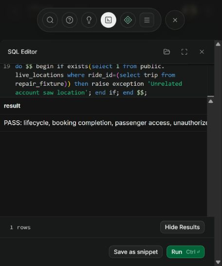
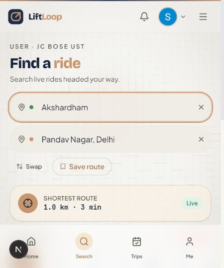

# LiftLoop repair status — 5 November 2026

## Implemented and deployed

- Applied `supabase/feature-repair-setup.sql` to the live project: all twelve missing feature tables, RLS, `user_stats`, passenger access and atomic ride lifecycle transitions.
- Created the three missing Storage buckets as private. Applied `supabase/private-storage-setup.sql`: scoped access, document approval protection and Realtime publication.
- Added expiring signed URL resolution for private files; stable references remain stored in records.
- Fixed shared route access and removed the `both` role's admin bypass. My Bookings permits signed-in roles.
- A passenger can open Create Ride and explicitly opt into offering rides. This updates their own account to `both`; admin privileges are unchanged.
- Fixed pickup autocomplete bubbling into the wrong map target. Actual signed-in browser test confirmed A stayed Akshardham and the map tap filled B with Pandav Nagar.
- Fixed endpoint clearing, local date pills/filtering and explicit departure instants. Past departure times are rejected at submission.
- Fixed ORS GET response negotiation. Routing now uses the configured Next.js ORS backend without the missing Mappls route function. Mappls remains the map display engine.
- Added direction checks for short reverse trips, search polling and query error feedback. Routing failures no longer receive invented travel times labelled live.
- GPS denial now asks for explicit selection rather than silently reporting Delhi as the user's position. Route caches separate travel profiles.
- Removed automatic completion at departure. Added Start/Finish controls using the transactional database operation. Paid bookings block ride cancellation until refunds are handled.
- Replaced fabricated dashboard earnings, savings series, trending counts, safety score and ratings with actual records, profile completeness or unavailable values.
- Enabled the missing toast renderer and initial notification loading. Local callback origin is preserved for login.

## User-selected service scope

Google sign-in and manual document review are used. Phone OTP UI and the missing AI document invocation were removed. SOS records an alert for the admin inbox and explicitly states that SMS/emergency-service dispatch is not configured. No missing OTP, AI or SMS function is falsely reported as deployed.

## Razorpay test payment changes

- Pending browser recovery records are isolated by user and ride; refunded records can clear.
- SDK loading has a timeout and recoverable retry state.
- Added a signed `payment.captured` webhook endpoint, using the provider's durable order notes and idempotent database fulfillment.
- Added compensating test refunds for a captured payment whose booking cannot be fulfilled.
- Added a rider-authorized cancellation/refund endpoint with a stable provider refund idempotency key and a service-only database finalization transaction. Pending refunds are not marked completed.
- Applied `supabase/refund-repair-setup.sql` live. Simulated payments remain explicitly separated.

**External setup still required:** configure a Razorpay test webhook for `payment.captured` at your publicly reachable `/api/payments/razorpay/webhook` endpoint and put the same private secret in `RAZORPAY_WEBHOOK_SECRET`. Localhost alone cannot receive provider callbacks. The endpoint deliberately returns 503 while this secret is absent. No live payments are enabled.

## Validation

- Production `npm run build`: passed, including TypeScript and all 33 generated pages.
- `npm run typecheck`: passed.
- `npm test`: 11 tests passed, including new access/cache/GPS regression tests.
- 15 local HTTP checks: expected auth/validation denials, successful routing/geocoding/static assets, explicit unconfigured-webhook response.
- Live Data API: all twelve tables exist and reject anonymous access; all three buckets are private.
- Live rollback-only SQL tests passed for driver start/finish, atomic booking completion, passenger ride/location access, denied passenger status change, unrelated-location denial and user statistics. Fixtures were rolled back.
- Actual browser confirmed the destination-selection correction. See `destination-tap-fixed.png`.

## Practical limits

There are still zero published rides and no bookings in the real project. No fake offers were left behind. Publish a future ride from one account, then search/book it from another to exercise the complete user flow.

A complete real-provider test checkout, refund, closed-tab webhook recovery, document upload/admin review and private attachment exchange have **not** been exercised end to end. The provider webhook configuration above remains outstanding. Code and database checks do not certify those user journeys.

The earlier 41-finding audit is a historical baseline. This repair addresses the requested critical groups; it is not a claim that every other finding in that report is resolved. In particular, more comprehensive concurrency tests for payment cancellation versus ride start, counterpart profile presentation, and remaining notification/admin UI flows still need work.

